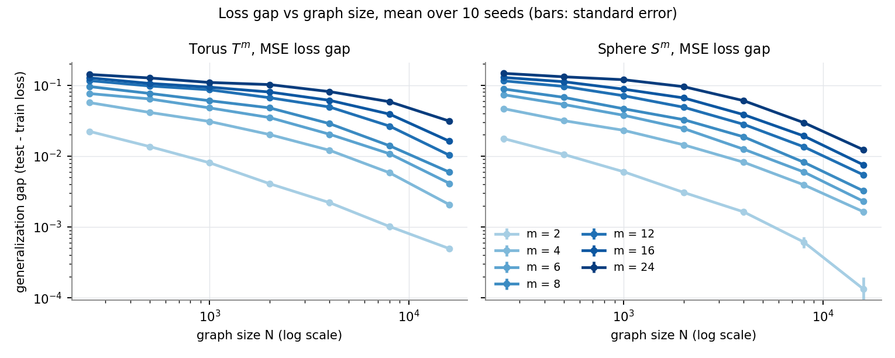
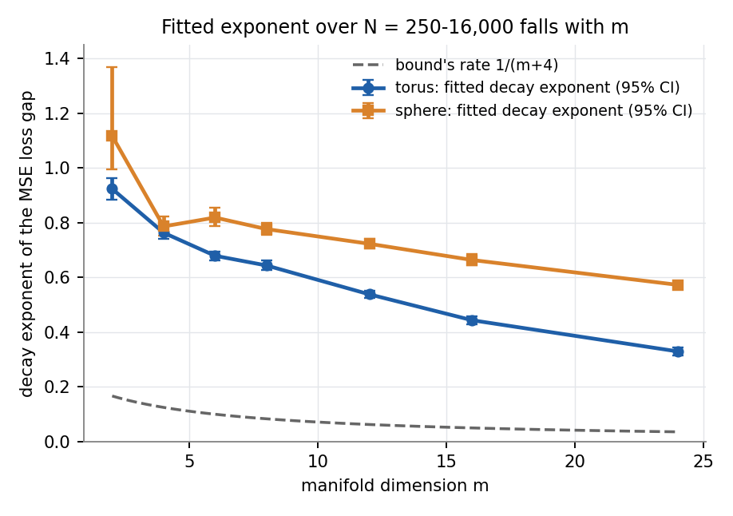
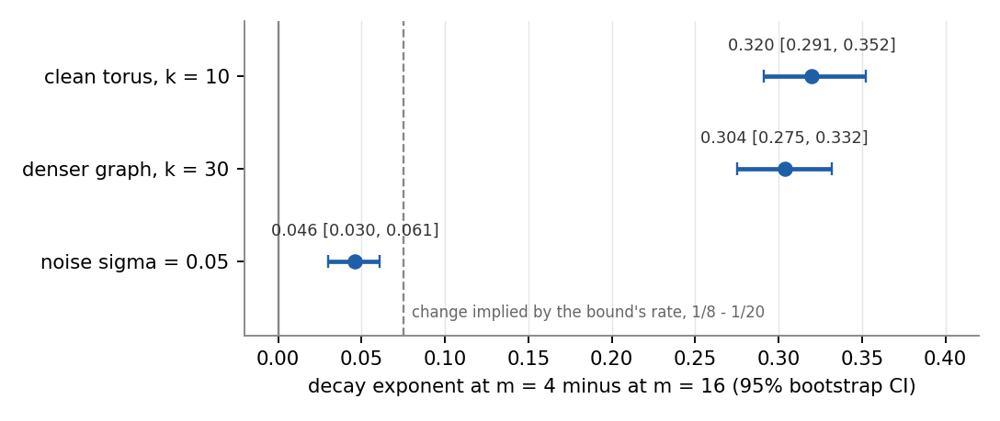
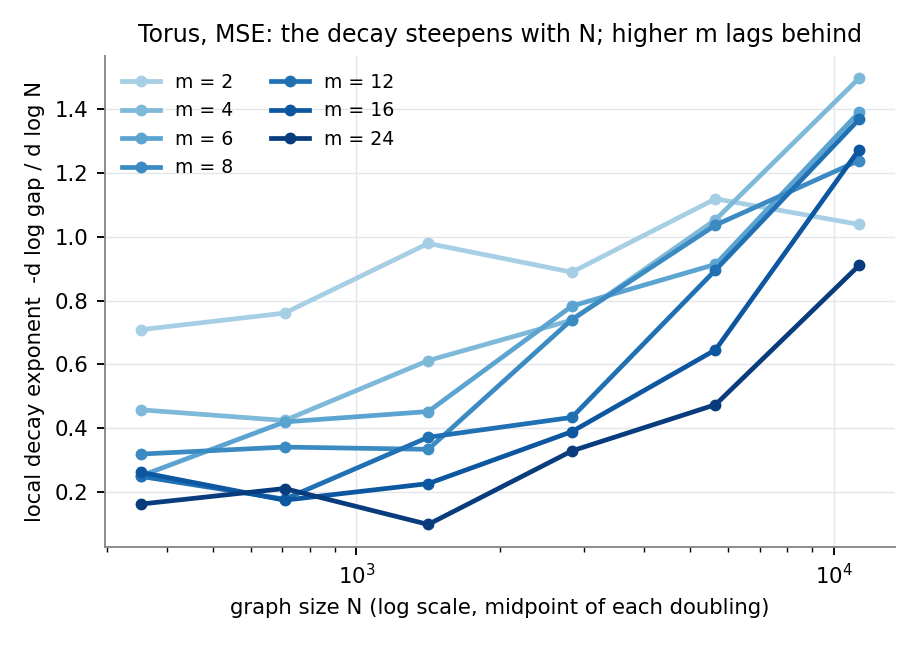

# Experiment A results: clean manifolds

Run on 2026-10-25 on the GPU server (2 GPUs, torch 2.5.1+cu124). Analysed on 2026-10-26 with the
frozen plan (`docs/analysis_plan.md`); deviations from it are listed there and summarised at the end.
Numbers come from `mdgap.analyze_decay_exponent` (pre-specified analysis) and
`scripts/experiment_a_followup.py` (everything else; output in `results/experiment_a_followup.txt`).

## In short

- **The pre-specified test supports H1 decisively.** On the torus with the MSE loss, the fitted
  decay exponent of the gap falls steadily from 0.92 at m = 2 to 0.33 at m = 24. The slope of the
  exponent on m is b1 = -0.0215 per dimension (one-sided 95% upper bound -0.0204; t = -41.6, 5 df).
- **It holds in every estimable secondary analysis** (sphere, cross-entropy gap, accuracy gap,
  log(N / log N) axis): all p <= 1.7e-4, so all survive Holm's correction. It also holds with a
  denser graph (k = 30).
- **Off-manifold noise almost removes it.** With noise sigma = 0.05 the difference between the
  exponents at m = 4 and m = 16 drops from 0.32 to 0.046.
- **The bound's rate is far too slow and has the wrong shape.** Every fitted exponent (torus and
  sphere) is 0.29-0.95 above 1/(m+4), and the exponents follow a/(m+c) with c of about 11, not 4.
- **Main caveat: the gap is not a single power law in N.** Its decay steepens with N at every m,
  and higher m stays on the flat part longer. Within N <= 16,000 the data show that the gap shrinks
  more slowly on higher-dimensional manifolds; they do not show that the asymptotic rate depends on m.

## Data check

- 2,240 runs as planned: 4 main files of 490 runs (7 m x 7 N x 10 seeds) and 2 robustness files of
  140 runs. All cells have 10 seeds, no duplicate runs, all on CUDA, all 2,000 epochs, k and noise as
  configured. Wall time about 1 h 50 min on 2 GPUs (at most 9 s per run).
- Training had levelled off for MSE: the training loss changed by at most 2.1% over the last 10% of
  epochs (1 of 490 torus runs above 2%). For cross-entropy, 17% (torus) and 9% (sphere) of runs were
  still changing by more than 2%, as the pilot predicted.
- 3 single runs have a gap <= 0, all on the sphere at m = 2, N = 16,000 (2 MSE, 1 CE; gaps between
  -0.0003 and -0.0001). No cell mean is <= 0, so no cell is excluded.
- Graphs: mean degree 11.2-11.9 (k = 10) and no isolated node in any run, so graph sparsity does not
  change with m.

## Primary analysis: torus, MSE loss gap

| m | fitted exponent | 95% interval | bound's rate 1/(m+4) | difference |
|---|---|---|---|---|
| 2 | 0.923 | [0.883, 0.963] | 0.167 | +0.757 |
| 4 | 0.763 | [0.739, 0.791] | 0.125 | +0.638 |
| 6 | 0.679 | [0.663, 0.695] | 0.100 | +0.579 |
| 8 | 0.643 | [0.626, 0.662] | 0.083 | +0.560 |
| 12 | 0.538 | [0.523, 0.552] | 0.063 | +0.475 |
| 16 | 0.443 | [0.429, 0.458] | 0.050 | +0.393 |
| 24 | 0.329 | [0.315, 0.344] | 0.036 | +0.294 |

- b1 = -0.0215, SE 0.00052, one-sided 95% upper bound -0.0204 < 0: **support for H1**.
- Total change of the exponent from m = 2 to 24: 90% interval [-0.496, -0.450]. The bound's rate
  changes by only -0.131 over the same range.
- The two bounds reported but not used for the decision agree: percentile -0.0207, residual-SE -0.0171.

## Secondary analyses

| analysis | b1 | one-sided 95% upper bound | t (5 df) | one-sided p | decision |
|---|---|---|---|---|---|
| sphere, MSE gap | -0.0125 | -0.0112 | -19.5 | 3.3e-6 | support |
| torus, cross-entropy gap | -0.0349 | -0.0324 | -29.0 | 4.6e-7 | support |
| sphere, cross-entropy gap | -0.0100 | -0.0077 | -8.7 | 1.7e-4 | support |
| torus, accuracy gap (MSE runs) | -0.0203 | -0.0193 | -39.9 | 9.3e-8 | support |
| sphere, accuracy gap (MSE runs) | -0.0136 | -0.0124 | -21.6 | 2.0e-6 | support |
| torus, MSE gap, x = log(N / log N) | -0.0249 | -0.0237 | -41.4 | 7.7e-8 | support |

The largest p-value, 1.7e-4, is below Holm's smallest threshold (0.05 / 6 = 0.0083), so all six
survive the correction.

- **Sphere.** The exponent falls from 1.12 (m = 2, wide interval [0.99, 1.37]) to 0.57 (m = 24), but
  not monotonically: 0.79 at m = 4 and 0.82 at m = 6 overlap. The sphere's exponents are higher
  than the torus's at every m >= 4.
- **Cross-entropy.** Formally supported, but the power-law fit is poor (R^2 down to 0.50 at torus
  m = 24). On the torus at m >= 16 the fitted slope over N = 250-2,000 is slightly positive (the gap
  grows with N there), and the gap still depends on the epoch count. Do not use these exponents as numbers.

## Robustness checks (torus, MSE, m = 4 and 16)

The planned b1 test needs at least 3 values of m and these arms have 2, so they are compared by
the difference between the exponents at m = 4 and m = 16 (95% bootstrap interval over seeds).

| arm | exponent m = 4 | exponent m = 16 | difference [95% CI] |
|---|---|---|---|
| clean torus, k = 10 | 0.763 | 0.443 | 0.320 [0.291, 0.352] |
| denser graph, k = 30 | 0.721 | 0.417 | 0.304 [0.275, 0.332] |
| noise sigma = 0.05 | 0.302 | 0.256 | 0.046 [0.030, 0.061] |

- **k = 30:** essentially the same result. The choice of k does not drive it.
- **Noise:** the dimension effect shrinks by a factor of 7, and the exponent at m = 4 drops from
  0.76 to 0.30. The noise is large at the scale of the graph. It is added in all 128 ambient
  coordinates, so its length is about 0.05 x sqrt(128) = 0.57 on a manifold of radius 1. At m = 4 and
  N = 16,000 it triples the median neighbour distance (0.28 to 0.81). A likely reading, not yet
  tested: what matters is the dimension the kNN graph sees at its neighbourhood scale, and noise
  raises it towards the ambient dimension for every m. For comparison, the realism ladder's noise
  levels (0.05 and 0.2 x the per-coordinate SD of the clean data, about 0.09) are about 0.004 and
  0.017, far below this arm.

## How to read the exponents: the gap is not a pure power law

- The log-log fit per m has R^2 from 0.99 (m = 2) down to 0.87 (m >= 12). The curves bend downward.
- Local exponents between successive sizes rise with N at every m. Between N = 8,000 and 16,000
  they are 1.04, 1.50, 1.39, 1.24, 1.37, 1.27 and 0.91 for m = 2 ... 24, with no clear order up to
  m = 16. Compared at the same gap level (e.g. gap = 0.03), the higher-m curves fall faster, not slower.
- So the falling fitted exponent mostly reflects that higher-m curves stay flat longer before
  they drop. That is a real effect of dimension over this range of N. It is not evidence about the
  asymptotic rate, which the bound is about. Statements should say "over N = 250-16,000".

Two things contribute to this shape and should be kept in mind:

- **Neighbourhoods are not local at high m.** The median kNN distance at N = 16,000 is 0.04 (m = 2),
  0.28 (m = 4), 0.65 (m = 8), 0.82 (m = 12), 0.91 (m = 16) and 1.02 (m = 24), on a manifold whose
  largest distance is 2. At m >= 12 the graph is far from the small-neighbourhood regime that the
  theory's asymptotics describe.
- **The model stops fitting the training set at large N and high m.** At m = 24 the training accuracy
  falls from 99.8% (N = 250) to 92.0% (N = 16,000), and the training loss rises from 0.011 to 0.041.
  So 28% of the gap's fall there comes from the training loss rising, not the test loss falling
  (8% at m = 4). The model has 32 hidden units.

## The hypotheses about the bound

- **H2 (descriptive):** consistent. Every fitted exponent is far above 1/(m+4), so the bound is
  loose by a wide margin in this setting.
- **H3 (exploratory):** a/(m+c) fits the torus exponents well with a = 12.1 and c = 11.3 (rms error
  0.018). With c fixed at 4, as in the bound, it fits poorly (rms 0.107). The exponent at m = 2 is 2.8
  times the one at m = 24, against 4.7 times for 1/(m+4). Because the exponents depend on the range
  of N (above), a and c do too.

## What this supports, and what it does not

Supported: over graph sizes 250-16,000, the generalization gap of this GNN shrinks more slowly
with N when the data manifold has higher dimension. This holds on two manifolds, for three ways
of measuring the gap, and for two graph densities. That is the qualitative dependence on m that the
bound suggests.

Not supported (yet): that the asymptotic rate depends on m as 1/(m+4), or at all. The bound's
rate is far slower than what is observed, and its shape does not match. Off-manifold noise of a
size comparable to the neighbour distances largely removes the dependence on m.

## Next steps

1. **Bookkeeping.** Commit the pending changes, this report, the follow-up script and the
   figures. The deviations are already recorded in the plan.
2. **Three short exploratory follow-ups** (a few hundred GPU runs each). Each answers a question
   the results raise, before moving to harder manifolds. They are recorded in the plan
   (Deviations, 2026-10-26); the configs are `configs/followup_*.yaml` and
   `bash jobs/run_experiment_a.sh followups 0 1` runs them (`docs/running_experiment_a.md`, step 7).
   - **Larger N: rate or onset?** Torus, MSE, m in {4, 12, 24}, N in {32,000, 64,000}, 10 seeds
     (60 runs). If the high-m local exponents keep rising
     towards those of low m, the dimension effect is a later onset, not a slower asymptotic rate.
     The kNN graph build at N = 64,000 runs on the CPU; time it first.
   - **Model capacity.** Hidden size 128 instead of 32, torus, MSE, m in {2, 8, 24}, all 7 N, 10
     seeds (210 runs). This checks whether the pattern survives when the model can still fit the
     large-N training sets.
   - **Noise sweep with the dimension the graph sees.** Torus, MSE, m in {4, 16}, noise sigma in
     {0.005, 0.01, 0.02} (0 and 0.05 exist), all N, 10 seeds (420 runs). Also run the ID estimators
     on the noisy point clouds; `calibrate_id.py` already reads `noise_sigma` from the config. Question:
     does the fitted exponent follow the estimated dimension at the graph's scale rather than m? This
     links directly to real embeddings and to the next step.
3. **Then the harder manifolds** (realism ladder in the plan). Since a trend was found, all rungs
   apply. The noise result suggests the off-manifold-noise rung will matter most for real data.
4. **For the paper:** main figure = gap vs N per m (torus and sphere) plus the fitted exponent vs m
   with the bound's rate. Report the local-exponent figure and the noise contrast as the honest
   limits of the claim.
