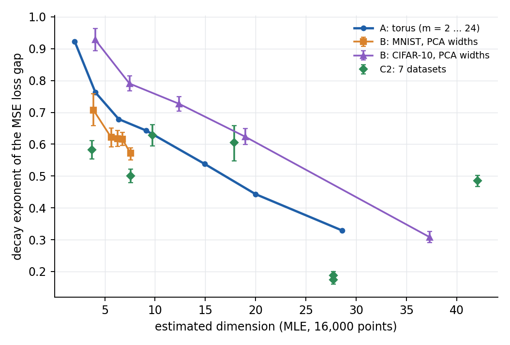

# Experiments B and C: results

2026-10-29 · Roy

## In short

The direction carries over, but only partly and with confounds. Every comparison has the predicted sign: a higher estimated dimension goes with a slower-decaying gap. That holds for MNIST and CIFAR-10 across PCA widths (Spearman ρ = −1 in both) and across the 7 datasets rerun with the new protocol (ρ = −0.60, exact p = 0.17).

The evidence is weaker than the sign suggests, for three reasons:

- **The only large contrast is CIFAR-10 across widths** (exponent 0.93 → 0.31). There, half or more of the gap's fall comes from the training loss rising (underfitting at large N), not the test loss falling.
- **MNIST's widths 8, 16 and 32 have overlapping intervals.** Its ρ = −1 rests on differences within the noise, plus width 4, where test accuracy drops to 66%.
- **The 7 datasets don't line up with experiment A's curve.** CelebA sits far below it, and 4 of the 7 datasets are flagged as not converged by the plan's rule.

C1 (the old gap curves) shows no relation (ρ = 0.13). MNIST and Fashion-MNIST lose most sizes there to negative gaps, as expected from the old graph construction.

Two data findings matter beyond this experiment. First, the Fashion-MNIST features the old GNN used are effectively 4-dimensional, and the PathMNIST ones about 15-dimensional. Second, the frozen plan file is missing from your repo.

## Download check

Everything is on your PC and complete: 1,190 of 1,190 runs, all 16 dimension-estimate labels, and both logs.

| What | Expected | Found |
| --- | --- | --- |
| B runs, `results/real_pca_width/` (MNIST, CIFAR-10) | 350 + 350 | 350 + 350; 10 seeds in every cell, no duplicates |
| C2 runs, `results/real_full/` (7 files) | 70 each | 70 each; 10 seeds in every cell, no duplicates |
| Settings | 2,000 epochs, CUDA | all runs 2,000 epochs on CUDA; widths, pool sizes and class counts as planned |
| Dimension estimates, `results/id_real/` | 16 labels × 3 methods | 16 × 3 files, 336 “ok” rows each, none failed |
| Logs, `logs/real_*.log` | 700 + 490 run lines | 700 + 490; no errors |

- **When it ran:** the runs took about 1.8 h of run time on two GPUs and ran on 2026-10-27, 20:19–21:18 server time (about 1 h wall time). That is after your code commit `515534e` (09:30 that day).
- **Not downloaded, and not needed:** nothing. The server still holds `data/real/` (1.3 GB). You can delete it with `rm -r ~/manifold-dim-gap/data/real`; your PC keeps its copy.

## Experiment B: PCA width

On CIFAR-10 the decay exponent falls steadily as the estimated dimension rises: 0.93 at 4 to 0.31 at 37, with non-overlapping intervals. Its slope is −0.018 per dimension (95% interval −0.019 to −0.017). On MNIST the change is small: 0.71 at width 4, then about 0.62 for widths 8–32, and 0.57 at width 128. Its slope is −0.035 per dimension (−0.050 to −0.021), over a narrow range of estimated dimensions (3.9–7.6).

| Dataset | PCA width | Exponent [95% CI] | MLE dimension | Test acc. at N = 16k | Share of gap fall from rising training loss | Fit R² |
| --- | --- | --- | --- | --- | --- | --- |
| MNIST | 4 | 0.71 [0.66, 0.76] | 3.9 | 66% | 33% | 0.996 |
| MNIST | 8 | 0.62 [0.59, 0.65] | 5.6 | 87% | 6% | 0.998 |
| MNIST | 16 | 0.62 [0.59, 0.64] | 6.3 | 93% | none (falls) | 0.995 |
| MNIST | 32 | 0.62 [0.60, 0.64] | 6.7 | 94% | none (falls) | 0.997 |
| MNIST | 128 | 0.57 [0.55, 0.59] | 7.6 | 94% | none (falls) | 0.994 |
| CIFAR-10 | 4 | 0.93 [0.89, 0.96] | 4.0 | 27% | 69% | 0.998 |
| CIFAR-10 | 8 | 0.79 [0.77, 0.81] | 7.5 | 34% | 68% | 0.998 |
| CIFAR-10 | 16 | 0.73 [0.70, 0.75] | 12.4 | 39% | 59% | 0.993 |
| CIFAR-10 | 32 | 0.62 [0.60, 0.65] | 19.0 | 41% | 51% | 0.975 |
| CIFAR-10 | 128 | 0.31 [0.29, 0.33] | 37.3 | 37% | 51% | 0.812 |

The last column but one is the training loss's rise from N = 250 to 16,000, as a share of the gap's fall. All three estimators rank the widths the same way, so ρ = −1 (exact p = 0.017) for each.

- **MNIST's ordering among widths 8–32 is within the noise.** Their intervals overlap almost completely. The ρ = −1 comes from width 4, where accuracy drops to 66%, and width 128.
- **CIFAR-10 has the plan's confound in full.** The model barely learns (test accuracy 27–41%, on 10 classes), and its training accuracy falls sharply with N (width 128: 83% at N = 250, 57% at 16,000). So at every width, half or more of the gap's fall is underfitting at large N.
- **CIFAR-10 at width 128 is not a power law over this range.** It is almost flat up to N = 2,000 (local exponent 0.07), then drops (0.58). This is the same delayed onset that experiment A showed at high m.
- **Convergence was fine.** At most 6% of runs per width were still changing by more than 2% at the end.

## Experiment C: the 7 datasets

With the new protocol (C2) the sign is as predicted, but the relation is weak. Spearman ρ between exponent and MLE dimension is −0.60 (exact p = 0.17); TwoNN and the correlation integral rank the datasets identically, so they give the same ρ. With the old gap curves (C1) there is no relation: ρ = 0.13 (p = 0.80).

| Dataset | MLE dimension | C2 exponent [95% CI] | C2 test acc. at 16k | Converged by the plan's rule | C1 exponent (old curves, sizes used of 8) |
| --- | --- | --- | --- | --- | --- |
| Fashion-MNIST | 3.7 | 0.58 [0.55, 0.61] | 78% | yes (0%) | 1.36 (5) |
| MNIST | 7.6 | 0.50 [0.48, 0.52] | 95% | yes (4%) | −0.89 (3) |
| PathMNIST | 9.7 | 0.63 [0.59, 0.66] | 61% | yes (1%) | 0.64 (8) |
| FER2013 | 17.9 | 0.61 [0.55, 0.66] | 33% | **no (19%)** | 1.45 (7) |
| CelebA, task gb | 27.8 | 0.19 [0.18, 0.20] | 81% | **no (47%)** | 0.69 (8) |
| CelebA, task sb | 27.8 | 0.17 [0.16, 0.19] | 77% | **no (51%)** | 0.68 (8) |
| CIFAR-10 | 42.1 | 0.48 [0.47, 0.50] | 44% | **no (20%)** | 0.89 (8) |

"Converged" counts the runs whose training loss still changed by more than 2% over the last 10% of epochs. The plan flags a dataset as not converged above 10%. In the flagged datasets the loss was mostly still falling. In CelebA, 40–44% of runs were still falling and 7% were rising.

- **The negative ρ rests mostly on CelebA.** CelebA's exponent (0.17–0.19) is far below every other dataset, which all lie between 0.48 and 0.63 with little order by dimension (ρ = −0.2 without CelebA). CelebA is also the least converged, and the only binary task.
- **C1 is not interpretable.** Under the old induced-subgraph protocol, MNIST keeps only 3 of 8 sizes with a positive mean gap, and Fashion-MNIST 5. Their exponents (−0.89, 1.36) are meaningless. C1 and C2 disagree for every dataset except PathMNIST. But C1 also differs in loss (cross-entropy) and training length (50 epochs), so the disagreement can't be pinned on the graph construction alone.
- **Exploratory, not in the plan for C2:** against the old repo's dimension estimates, C2 gives ρ = −0.88 (MLE), −0.99 (TwoNN) and −0.85 (correlation integral). Those estimates were computed on different vectors from the ones the GNN used (`*_train_embeddings.npy`). So the exponents line up with the dimension of vectors the GNN never saw, and why is unclear. Treat it as a lead, not a result.

## Against experiment A

The real-data points follow the torus curve's downward trend but not its level, so the plan's second condition for "consistent with A" is only partly met. The torus is placed at its own MLE estimate (true m = 2–24), so both axes use the same estimator.

- **CIFAR-10 widths:** parallel to the torus curve, but 0.13–0.17 higher at every estimate (e.g. 0.73 vs 0.59 at about 12).
- **MNIST widths:** 0.06–0.08 below the curve, over a short stretch of it (estimates 3.9–7.6).
- **C2 datasets:** PathMNIST lies on the curve. Fashion-MNIST, MNIST and CelebA lie 0.16–0.20 below it, and FER2013 0.13 above. CIFAR-10 (42) is beyond the torus's range.
- **The same CIFAR-10 images give different exponents depending on the features.** The full 4096-d features give 0.48 at an estimate of 42. Their top 128 principal components give 0.31 at 37. So the estimated dimension does not fix the exponent on its own.

## Caveats

- **The frozen plan is not in your repo.** `docs/analysis_plan_bc.md` was written on 2026-10-26, before any run. It was never committed, though: it is missing from commit `515534e` and from your folder. I still have the exact file (SHA-256 starting `e11b2ba9`). Restoring and committing it with a dated note keeps the record honest. All analysis here follows that file.
- **Some old features are nearly flat.** The Fashion-MNIST features the old GNN used are 256-d, but 4 directions carry essentially all of the variance (the 5th singular value is 1.6% of the largest). PathMNIST has about 15 such directions. That explains their low estimates (3.7 and 9.7). It may also matter for the old paper results; where these files came from is still unconfirmed.
- **Four datasets were not converged at 2,000 epochs:** CIFAR-10, FER2013 and both CelebA tasks. Their exponents describe this training length only.
- **Underfitting drives part of every large-N gap.** It accounts for 14–43% of the gap's fall in 6 of the 7 C2 datasets (none for MNIST), and 51–69% for CIFAR-10 in B (hidden size 32). Experiment A's capacity follow-up (hidden 128) is the direct check.
- **The dimension estimates are biased above about 6** (experiment A's calibration). Only rankings and rough positions are meaningful.
- **Everything here is descriptive**, as the plan fixed: the p-values are exact permutation p-values over 5 or 7 points, with no correction across analyses.
